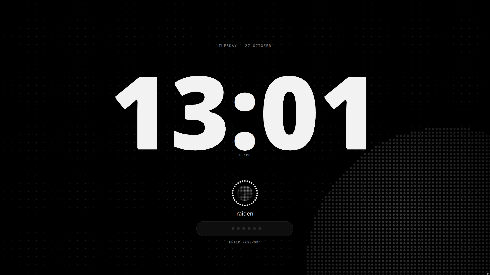

# NothingOS — SDDM Theme

**NothingOS** is a clean, minimal desktop theme for **SDDM** (System Display Manager). Built with Qt 6 QML, it draws a soft black dot-grid canvas with a subtle orb, uses the **Doto** font for the clock, and renders the password pill as dots — giving a calm, modern look on Linux systems.



## Features

- Minimal, dark-themed panel with a dot-grid canvas and subtle orb background
- 24-hour clock rendered with the Doto font
- Dot-matrix avatars and password pills
- Optional wallpaper support drawn as a dot matrix
- Fully configurable via `theme.conf` (background, grid, colors, clock, etc.)

## Requirements

- Qt 6 (for the QML theme)
- SDDM version 2.0 or newer (Theme-API 2.0)

## Installation

```bash
# Clone the theme repository
git clone https://github.com/duckpah/Nothing-SDDM

# Copy the theme into SDDM's theme directory
sudo cp -r /Nothing-SDDM /usr/share/sddm/themes

# Restart SDDM and select the theme
```

Then add this to `/etc/sddm.conf`:

```ini
[Theme]
Current=NothingSDDM
```

## Configuration

Adjust appearance through `theme.conf` (e.g., `[General]`):

- `background` — optional wallpaper (path or file URL, drawn as dots)
- `backgroundDots` — render wallpaper as dots
- `clock24` — use a 24-hour clock
- `grid` / `orb` — toggle the dot-grid canvas and the subtle orb
- `bg` / `panel` / `line` / `grey` / `fg` / `accent` — panel colors

See the `theme.conf` in this repository for the full list of options.
